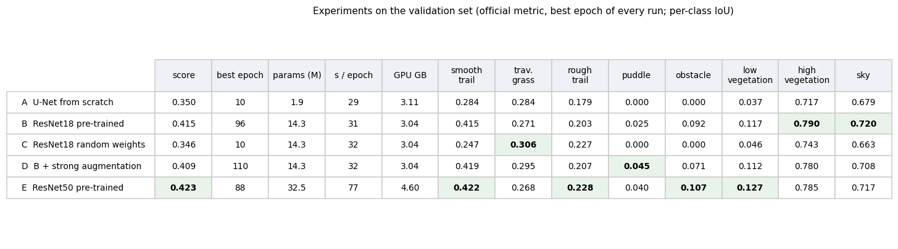
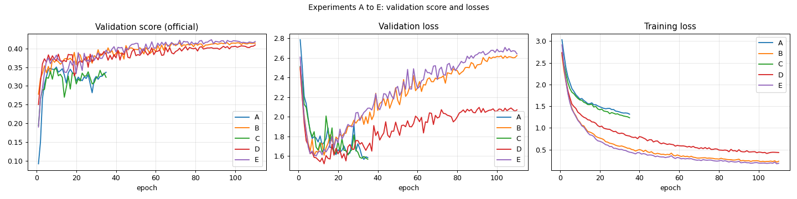
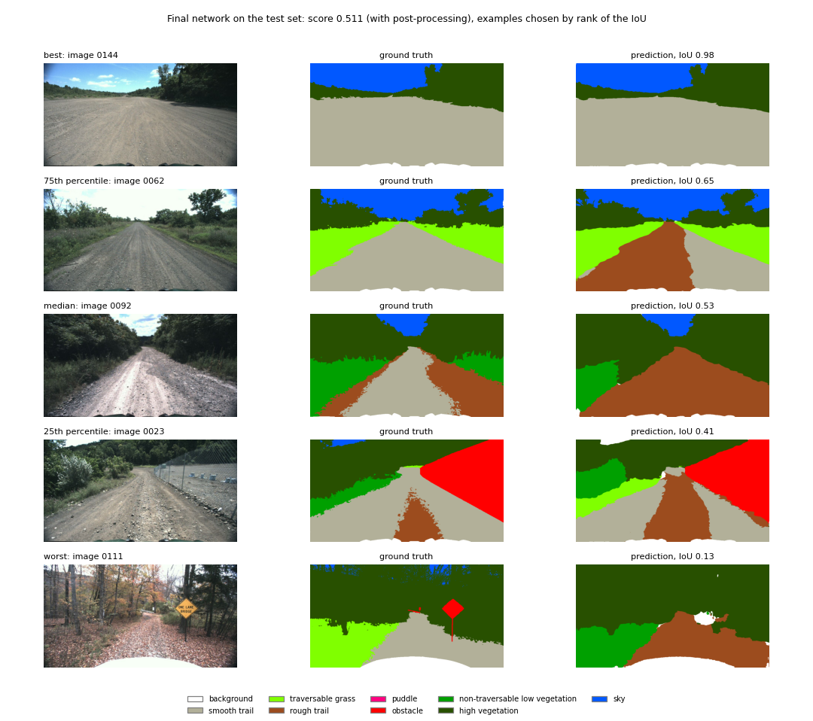

# Off-road Semantic Segmentation

Pixel-wise segmentation of images from a camera mounted on a moving car in a rural environment,
into 8 classes (sky, high vegetation, smooth trail, rough trail, traversable grass,
non-traversable low vegetation, puddle, obstacle). Built with **PyTorch** on a small, noisy,
highly correlated dataset (931 labelled frames), with a strong focus on **trustworthy evaluation**:
a leakage-aware train/validation split, a faithful re-implementation of the official metric, one-change-at-a-time
experiments, and error analysis that drove the final design.

| | |
|---|---|
| **Test score** (official metric, 145 held-out images, 1024x544) | **0.511** (0.479 without post-processing) |
| Network | U-Net with a pre-trained ResNet18 encoder, 14.3 M parameters |
| Speed / memory at test time | about 47 fps, 0.14 GB of GPU memory (RTX 3060 Laptop) |
| Training cost | about 45 s per epoch, 3.0 GB of GPU memory, 110 epochs |

The dataset can be found in https://theairlab.org/yamaha-offroad-dataset/.

## The problem

The score is the IoU of each class, computed **per image**, averaged over all the (image, class)
pairs. Three properties of this setting shaped the whole project:
(1) consecutive frames are near duplicates, so a random split leaks the validation set into training;
(2) the classes are very unbalanced (puddle covers 0.2% of the pixels) but each counts as much as the sky;
(3) predicting a class that is *absent* from an image, even on a few pixels, gives IoU 0 for that pair.
Constraints of the project: no extra training data, less than 5 GB of GPU memory in training and
4 GB in test, and the evaluation also considers speed.

## What is in this project

- **Leakage-aware split** ([docs](docs/data_analysis_&_split.md)). The decorrelation distance between frames was
  measured (about 5 frames) and the data split into contiguous blocks cut at scene changes, assigned whole
  to train or validation while balancing the class distribution, with a purge gap around the validation
  blocks. The validation score of this split can be trusted; a random split would not be.
- **Exact metric** ([`src/metrics.py`](src/metrics.py)). A GPU implementation of the NaN-aware mean over image-class pairs, tested against a NumPy reference.
- **Loss for imbalance** ([`src/losses.py`](src/losses.py)). Class-weighted cross-entropy plus a soft Dice term,
  with weights `(f_max / f_c) ** 0.5` capped at 20, computed on the training set only.
- **Data pipeline** ([`src/dataset.py`](src/dataset.py)). Online augmentation with Albumentations, chosen from
  the data analysis (horizontal flips yes, vertical flips and hue shifts no), and two augmentation profiles.
- **Models** ([`src/models.py`](src/models.py)). A U-Net written from scratch, and U-Nets with a ResNet18 or
  ResNet50 encoder, with and without ImageNet pre-training.
- **Training** ([`src/train.py`](src/train.py)). Mixed precision, warmup + cosine schedule, differential
  learning rates, early stopping, resumable checkpoints, and an experiment runner driven by one config file
  (`python -m src.train --experiment B`).
- **Prediction and evaluation** ([`src/predict.py`](src/predict.py)). The `predict` function required by the
  project (any image size, any batch size) with its post-processing, and the evaluation code of the course.
- **206 automated tests** ([`tests/`](tests)), on synthetic data: shapes and types, alignment of image and mask
  under augmentation, equivalence with reference implementations, resumption of training, and more.
  Most of the tests were checked by deliberately breaking the code and verifying that they fail.

## Experiments

All the experiments use the same split and the same loss. Validation scores (official metric, 186 images):

| Exp. | What changes | Val. score | Best epoch | Cost |
|---|---|---|---|---|
| A | U-Net written from scratch, random weights | 0.350 | 10 | 1.9 M params, 29 s/epoch |
| **B** | **ResNet18 encoder pre-trained on ImageNet + U-Net decoder** | **0.415** | 96 | 14.3 M params, 31 s/epoch |
| C | the network of B with random weights | 0.346 | 10 | same as B |
| D | B + strong augmentation + weight decay 5e-2 | 0.409 | 110 | same as B |
| E | B with a ResNet50 encoder | 0.423 | 88 | 32.5 M params, 77 s/epoch, 4.6 GB |
| F | **final network**: recipe of B on all 931 frames, last epoch kept | no held-out data | 110 | same as B |





*The validation score of the pre-trained networks (B, D, E) keeps growing slowly for about 90 epochs, while the
validation loss of the unregularised ones (B, E) rises after the first 10 epochs: the networks become overconfident
without segmenting worse.*

What the experiments showed (details in [docs/training.md](docs/training.md)):

- **Pre-training is what matters:** B against C, the same network, is worth +0.069. A from-scratch network
  stops improving after about 10 epochs; the pre-trained one keeps improving for about 90.
- **The networks overfit, but regularising does not help the metric.** B reaches 0.87 on the training images and
  0.415 on validation. D overfits much less (its validation loss is far lower) and scores the same
  within noise (0.409).
  The loss and the score disagree because the loss punishes confident mistakes while the score only looks at the
  argmax: D is better calibrated, not better at segmenting.
- **A bigger encoder does not help either:** E (ResNet50) is within noise of B (0.423 against 0.415) at twice the training time,
  half the speed and a peak memory close to the 5 GB limit. The limits are the ambiguous labels and the small
  number of independent scenes, not the capacity of the network.
- **The resolution is not a limit:** B evaluated at full resolution scores 0.4150, against 0.4152 at the
  training resolution (512x272).
- **Most of the lost score comes from false positives on absent classes.** In B, 28% of the valid
  image-class pairs were zeros of that kind. This led to the post-processing below.

Differences below about 0.01 are within the noise of the validation set, and the experiments were not
used to claim anything finer than that.

## Final network and test score

The final network (F) is trained on every labelled training frame, with no validation set left, so
it uses no early stopping and keeps the last epoch (the validation score of B was flat at the end of
training). It is evaluated on a separate labelled test set of 145 images (`data/test`) that the
training code never reads.

| | Plain argmax | With post-processing |
|---|---|---|
| **Score (official)** | 0.4794 | **0.5106** |
| Mean class IoU | 0.392 | 0.409 |
| Frames per second (1024x544, one image at a time) | 61-70 | 47 |

**Post-processing.** A class that covers less than 2% of an image is removed from it and its pixels go to the
next best class (puddle and obstacle are exempt, being small by nature). It exploits the structure of the metric,
adds +0.031 and needs no retraining. The threshold was chosen on the validation set of the experiments
(a plateau between 1% and 3%), not on the test set.

Per-class IoU on the test set (with post-processing): sky 0.835, high vegetation 0.778, traversable grass 0.478,
smooth trail 0.403, rough trail 0.306, obstacle 0.281, non-traversable low vegetation 0.193, **puddle 0.000**.
The weak classes are the ones with subjective labels or very few examples, and puddle (6 test images) is
not detected at all: an honest weakness of the project. The test set is small, so the score has an uncertainty
of the order of 0.01-0.02.



*Five test images chosen by the rank of their IoU (best, 75th percentile, median, 25th percentile, worst), not
hand-picked. The network separates sky, vegetation and trail well. The typical errors are in the confusion between
rough trail and smooth trail (rows 2 and 3, where the labels themselves are subjective) and in the small objects:
in the worst image the sign, labelled as obstacle, is missed.*

## Getting started

Tested with Python 3.12, PyTorch 2.2.2 (CUDA 12.1) and Albumentations 2.0 on Windows, with an NVIDIA RTX 3060
Laptop GPU (6 GB). It also runs on the CPU, much more slowly.

```bash
conda create -n seg python=3.12
conda activate seg
pip install -r requirements.txt  # install the PyTorch build for your CUDA version first
pip install jupyter               # only to open the notebooks
```

**Data.** Put the training samples in `data/train/<id>/{rgb.jpg,labels.png}` and the test samples in
`data/test/<id>/...`. The dataset is not distributed with this repository.

```bash
python -m pytest                                   # the whole test suite
python scripts/make_figures.py                     # the figures of this README, in docs/figures/
python -u -m src.train --experiment B              # one of the experiments of src/config.py (A to F)
python -u -m src.train --experiment F              # the final network -> outputs/experiment_F/final.pt
python -u -m src.train --experiment B --resume     # continue an interrupted run
```

Notebooks, to be run in order from the `notebooks/` folder:

1. [`01_data_analysis_&_split.ipynb`](notebooks/01_data_analysis_&_split.ipynb): exploratory analysis, leakage study and creation of the split.
2. [`02_training.ipynb`](notebooks/02_training.ipynb): data pipeline, comparison of the experiments and their curves.
3. [`03_test.ipynb`](notebooks/03_test.ipynb): score of the final network on the test set.

Prediction from Python:

```python
from src.predict import load_model, predict

model = load_model()                    # outputs/experiment_F/final.pt
labels = predict(model, image)          # image (H, W, 3) uint8    -> labels (H, W) uint8
labels = predict(model, batch)          # batch (B, H, W, 3) uint8 -> labels (B, H, W, 1) uint8
```

All the hyperparameters are in [`src/config.py`](src/config.py): the experiments differ only by their entry
in that file, so none of them needs code changes. Trained weights are written to `outputs/` and are not
versioned.

## Repository layout

```text
src/
  config.py      all the hyperparameters and the definition of the experiments
  data.py        loading, class names, exploratory analysis helpers
  split.py       leakage-aware block split
  dataset.py     Dataset, augmentation profiles, dataloaders
  losses.py      weighted cross-entropy + Dice
  metrics.py     the official metric
  models.py      U-Net, U-Net with a ResNet18 / ResNet50 encoder
  train.py       training loop, experiment runner, comparison tools
  predict.py     predict function, post-processing, evaluation
tests/           206 tests
scripts/         make_figures.py: regenerates the figures of this README (docs/figures/)
notebooks/       analysis, training, test
docs/            written documentation (see below)
```

## Documentation

- [Dataset analysis and split](docs/data_analysis_&_split.md): what the data looks like, the leakage problem and how the split solves it.
- [Training setup](docs/training.md): split protocol, pipeline, loss, metric, models, training procedure, the six experiments.
- [Prediction and test score](docs/prediction.md): the `predict` function, the post-processing and the test results.

## Limitations and next steps

- The final network has no held-out validation set by construction, so its quality is estimated by the test set
  (145 images) and by the validation score of experiment B (about 0.41 without post-processing).
- Each experiment is run once with one seed. Differences below 0.01 cannot be resolved; a block-wise
  cross-validation would give a more stable comparison.
- Puddle is not detected on the test set. Its labels are noisy, and a dedicated treatment (for example a
  specific loss or a one-class detector) would be the first thing to try.
- The class weights, the threshold of the post-processing and the learning rates were not tuned in detail.
- Other ideas: ensembling (about +0.006 over the best single network for three networks on validation, not worth
  the cost in speed), test-time augmentation (+0.002 on validation, within noise), a different decoder or a transformer encoder.

## License

The code is released under the [MIT License](LICENSE). The dataset belongs to the course organisers and is not
included in this repository, nor covered by this license.
